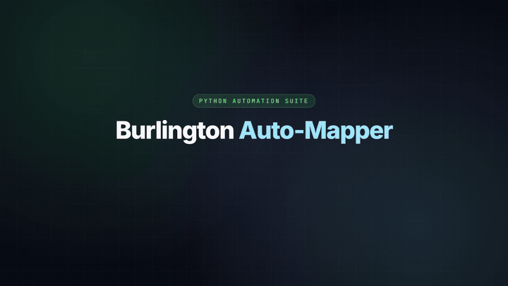
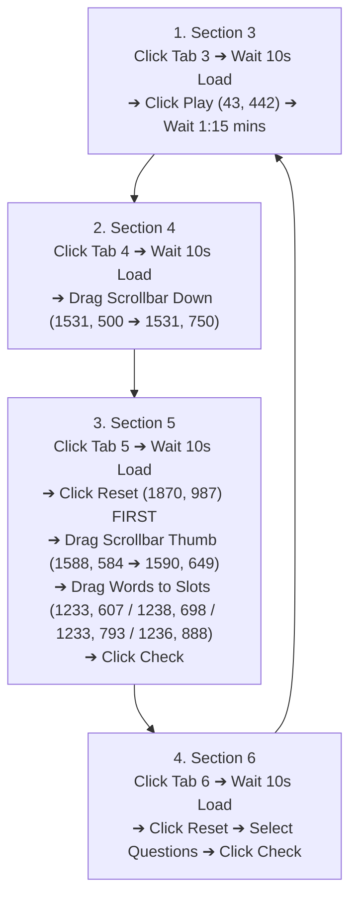

# BurlingtonEnglish Auto Clicker & Mover

An automated mouse clicker, mover, visual shuffle solver, and drag-and-drop tool tailored for BurlingtonEnglish exercises — plus **Genral Sync**, a universal sequence builder that works on any screen resolution.



> 🎬 **Full 1080p HD Video (with audio):** [Burlington_Automation_Showcase.mp4](Burlington_Automation_Showcase.mp4)

---

## 🚀 How to Run

### Method 1: Double-Click Launcher (Easiest)
Simply double-click **`run.bat`** in this folder (`E:\Auto Clicker scrip`).

### Method 2: Python Command
Run the Graphical Dashboard:
```bash
python gui_controller.py
```
Or run directly in terminal (CLI mode):
```bash
python auto_clicker.py
```

---

## ⌨️ Hotkeys & Controls

| Hotkey | Action | Description |
| :--- | :--- | :--- |
| **`F6`** | **Start / Resume** | Begins the automation (or resumes if paused). |
| **`F7`** | **Pause** | Pauses or unpauses the automation. |
| **`F8`** | **Set Play Button** | Hover your mouse over the Section 3 play button and press **F8** to calibrate its position instantly! |
| **`Esc`** | **Stop / Exit** | Stops the automation in CLI mode. |
| **Fail-Safe** | **Corner Slam** | Push mouse to any of the 4 screen corners to immediately abort. |

---

## 📋 The Updated Automation Sequence



1. **Section 3**:
   - Clicks Tab **3** `(745, 328)`
   - **Waits 10 seconds** for section to fully load
   - Clicks the **Play Button** at `(43, 442)`
   - Waits **1 minute 15 seconds** (75 seconds) with live countdown
2. **Section 4**:
   - Clicks Tab **4** `(825, 328)`
   - **Waits 10 seconds** for section to fully load
   - Drags scrollbar from `(1531, 500)` down to `(1531, 750)` + wheel scroll
   - Waits 3 seconds
3. **Section 5**:
   - Clicks Tab **5** `(905, 328)`
   - **Waits 10 seconds** for section to fully load
   - Clicks **Reset** `(1870, 987)` **first** (so resetting doesn't undo the scroll)
   - Drags side scrollbar thumb from `(1588, 584)` to `(1590, 649)` so all 4 questions are in range
   - Drags words into exact slots:
     - Pill 1 (*Information about style*) ➔ Slot 1 `(1233, 607)`
     - Pill 2 (*Description of technique*) ➔ Slot 2 `(1238, 698)`
     - Pill 4 (*Critic's overall opinion*) ➔ Slot 3 `(1233, 793)`
     - Pill 3 (*Critic's interpretation*) ➔ Slot 4 `(1236, 888)`
   - Clicks **Check** `(1780, 987)`
4. **Section 6**:
   - Clicks Tab **6** `(985, 328)`
   - **Waits 10 seconds** for section to fully load
   - Clicks **Reset** `(1870, 987)`
   - Selects options `[1, 6, 7, 8]`
   - Clicks **Check** `(1780, 987)`
5. **Loop**:
   - Automatically returns to **Section 3** and repeats indefinitely.
